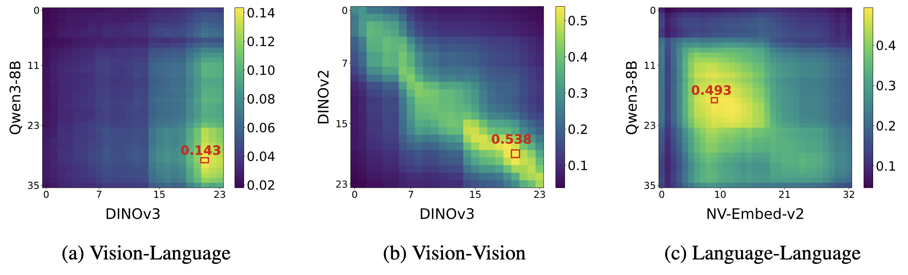
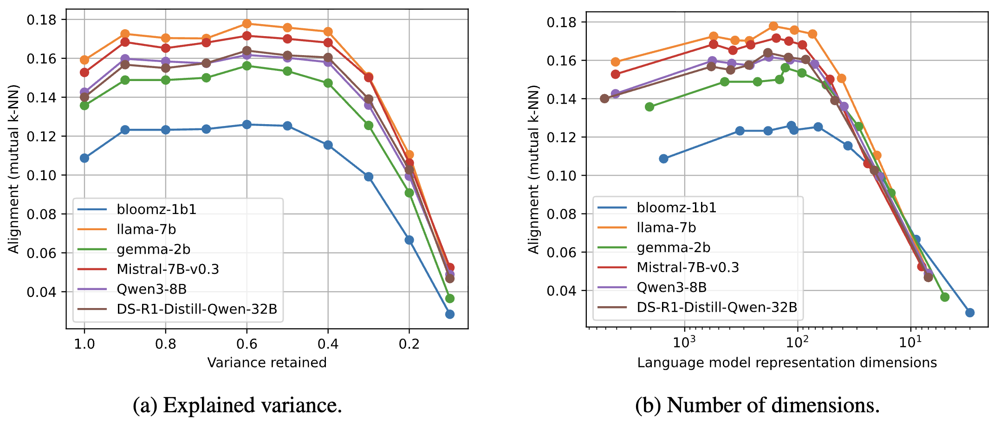
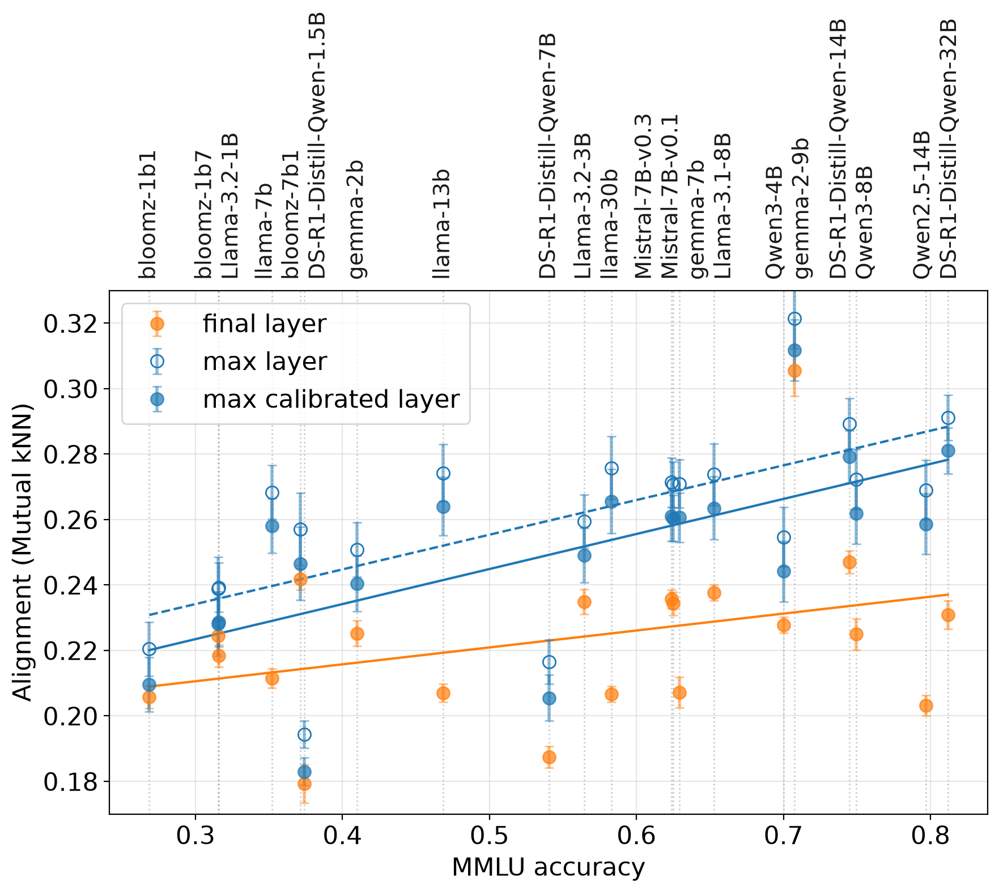
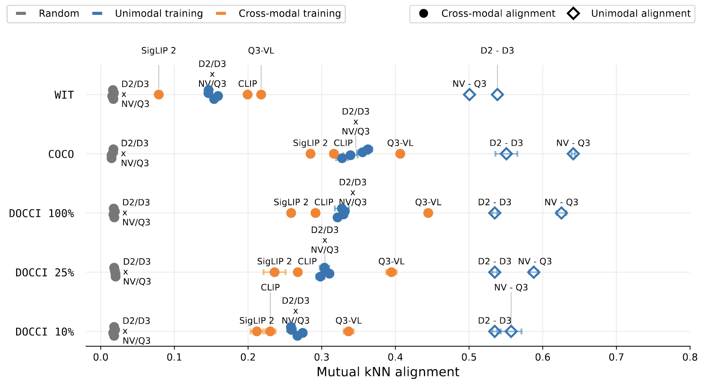

# Where Does Alignment Emerge and What Does It Mean? A Closer Look at the Platonic Representation Hypothesis

[Julia Herbst](https://www.eml-munich.de/people/julia-herbst),
[Simon Roschmann](https://www.eml-munich.de/people/simon-roschmann),
[Quentin Bouniot](https://qbouniot.github.io),
[Zeynep Akata](https://www.eml-munich.de/people/zeynep-akata)

[](https://arxiv.org/abs/2611.12869)
[](https://www.python.org/)
[](LICENSE)

**Presented at the following workshops:**
- Neural Network Artifacts as a New Data Modality @ NeurIPS 2026 (Spotlight Talk)
- Symmetry and Geometry in Neural Representations @ NeurIPS 2026
- Unifying Representations in Neural Models 2026

## Abstract

The Platonic Representation Hypothesis (PRH) suggests that neural networks are converging toward similar representation spaces. As language models become more capable, their representations are aligning with those of vision models. However, recent work has questioned whether this trend continues to hold for newer language models. Moreover, it has been shown that representation similarity metrics can be confounded by model depth and width, requiring appropriate baselines for interpretation. In this work, we first investigate where alignment emerges between unimodal models across model layers and representation dimensions. Next, we find that the PRH capability-alignment trend persists for newer models as long as the captions are sufficiently clean and informative. Finally, we contextualize cross-modal alignment, introducing unimodal and multimodal baselines on various datasets. Our results show that the cross-modal representational alignment of unimodal models can surpass that of explicitly aligned vision-language models, but remains substantially behind the alignment observed for models of the same modality.

## Installation

```bash
conda create -n prhcl python=3.11 -y
conda activate prhcl
python -m pip install -r requirements.txt
```

All commands are run as modules from the repository root, e.g. `python -m tools.extract_features ...`. All experiments can be run on a single NVIDIA A100 GPU with 80 GB memory.

## Data

By default, datasets are expected in `data/` and results are written to `results/`. To use other locations, copy `local_paths.env.example` to `local_paths.env` and set the paths, or set the same variables in your environment (e.g. `export PRHCL_DATA_DIR=/path/to/datasets`). `python -m src.paths` prints all resolved locations.

| Dataset | `--dataset` | Source |
| --- | --- | --- |
| WIT (1024 samples from [Huh et al.](https://github.com/minyoungg/platonic-rep)) | `wit_1024` | downloaded automatically from Hugging Face ([`minhuh/prh`](https://huggingface.co/datasets/minhuh/prh)) |
| [COCO 2017](https://cocodataset.org/#download) | `coco` | train images and annotations unzipped into `data/coco/` |
| CC3M with DreamLIP captions | `cc3m_recaptioned` | prepared as in [SOTAlign: Download CC3M](https://github.com/ExplainableML/SOTAlign#download-cc3m) |
| DOCCI (full and summarized captions) | `docci_with_summaries` | generated from the original DOCCI release files in `data/docci/` (see below) |

DOCCI is used with its full captions and with summarized captions (10%, 25%, 50% and 75% of the original length, written by Qwen3-8B). Both come from one dataset, built from the original [DOCCI](https://google.github.io/docci/) release files: `docci_descriptions.jsonlines` and the images from `docci_images.tar.gz`, unpacked into `data/docci/` (→ `data/docci/images/`).

```bash
python -m tools.generate_docci_summaries --model Qwen/Qwen3-8B
```

The prompt is given in Appendix H of the paper. The dataset is saved to `data/docci_with_summaries` and selected with `--dataset docci_with_summaries --caption_type <description|caption_75|caption_50|caption_25|caption_10>`, where `description` is the full original DOCCI caption.

## Pipeline

Alignment is computed in two (optionally three) steps.

### 1. Extract features

`tools/extract_features.py` encodes `--num_samples` image-caption pairs (default 1024) of a dataset with every given model and saves the representations of all layers to one `features.pt` per model. Each seed (`--seeds`) draws a different sample of the dataset; alternatively, `--num_seeds <n>` draws `n` random seeds, one run each (the seeds appear as folder names of the features). With `--random_init`, randomly initialized models are used instead of the pretrained weights. Language models are mean-pooled and vision models use the CLS token. The VLMs follow the same scheme where possible (SigLIP 2 has no CLS token and is mean-pooled over patches, Qwen3-VL-Embedding uses the last token, as in its embedding).

```bash
python -m tools.extract_features \
    --dataset docci_with_summaries --caption_type description \
    --modality all \
    --language_models Qwen/Qwen3-8B nvidia/NV-Embed-v2 \
    --vision_models facebook/dinov2-large facebook/dinov3-vitl16-pretrain-lvd1689m
```

### 2. Reduce features with PCA (optional)

`tools/reduce_features.py` fits a separate PCA for every layer and keeps the given fractions of variance. The reduced features are saved next to the original ones and used by `measure_alignment.py --pca_mode`.

```bash
python -m tools.reduce_features \
    --dataset wit_1024 --modality language \
    --models Qwen/Qwen3-8B \
    --pca_modes 0.9 0.8 0.7 0.6 0.5 0.4 0.3 0.2 0.1
```

### 3. Measure alignment

`tools/measure_alignment.py` computes the mutual k-NN alignment between every layer of every x-y model pair and saves one CSV per pair. With `--depth_calibration`, the calibrated mutual k-NN score of [Gröger et al.](https://github.com/mlbio-epfl/Aristotelian) is additionally saved to a `_summary.csv`.

```bash
python -m tools.measure_alignment \
    --dataset docci_with_summaries \
    --modality_x language --captions_x description --language_models Qwen/Qwen3-8B nvidia/NV-Embed-v2 \
    --modality_y vision --vision_models facebook/dinov2-large facebook/dinov3-vitl16-pretrain-lvd1689m \
    --metric mutual_knn --topk 10 \
    --depth_calibration
```

Further options: `--random_init_x/--random_init_y` for randomly initialized models, `--pca_mode` for PCA-reduced features, `--subsample_n` for subsamples of the 1024 pairs, and `--unique_pairs` to compute each pair only once when x and y are the same models (e.g. language-language).

## Reproducing the results

This section is organized along the three questions of the paper. The commands reproduce the figures with the models and datasets used there. Other models can be added in the same way.
To repeat a run on several samples of a dataset, add `--seeds` to `extract_features` and `measure_alignment`.

### Where does alignment emerge across layers and dimensions?

**Layer-wise heatmaps** (Figure 1, Appendix B). After extracting the features and measuring the alignment on WIT (see [Pipeline](#pipeline)), plot a heatmap for every model pair in a results folder:

```bash
python -m plots.plot_alignment \
    --alignment_root results/alignment/wit_1024/language_avg_vision_cls/pca=None/mutual_knn/topk=10/pretrained \
    --heatmap_root results/plots/heatmaps/wit_1024/language_avg_vision_cls
```

<p align="center">
  
</p>
<p align="center"><em>Layer-wise mutual k-NN alignment on WIT for a vision-language, a vision-vision and a language-language model pair. The red box marks the maximally aligned layer pair.</em></p>

**Alignment under PCA compression** (Figure 2, Appendix C). After extracting the features of the language models and DINOv2 on WIT, `scripts/measure_alignment_pca.sh` reduces them with a separate PCA per layer and measures the alignment for every PCA mode (dataset, models and PCA modes can be set at the top of the script). The plot shows the alignment against the retained variance and the number of dimensions:

```bash
bash scripts/measure_alignment_pca.sh
python -m plots.plot_alignment_vs_pca \
    --dataset wit_1024 --model_y facebook/dinov2-large \
    --pca_modes None 0.9 0.8 0.7 0.6 0.5 0.4 0.3 0.2 0.1
```

<p align="center">
  
</p>
<p align="center"><em>Alignment between DINOv2 and language models on WIT under PCA compression, plotted against (a) the retained variance and (b) the number of language-model dimensions.</em></p>

### Does higher alignment indicate stronger model performance?

**Benchmark scores.** MMLU, ARC Challenge and GSM8K are evaluated for every language model with the [LM Evaluation Harness](https://github.com/EleutherAI/lm-evaluation-harness), one job per task with `sbatch slurm/benchmark_llm.sbatch <mmlu|arc_challenge|gsm8k>`. The results are saved to `benchmark_results/`.

**Alignment with DINOv3.** Measure the alignment of the language models with `facebook/dinov3-vitl16-pretrain-lvd1689m` with `--depth_calibration`, which additionally saves the calibrated score, on `wit_1024`, `cc3m_recaptioned` (`--captions_x shortSV_captions`), and `docci_with_summaries` (`--captions_x description` for the full captions and `--captions_x caption_10`).

**Plots** (Figures 3 and 4, Appendix D). One plot per dataset and benchmark, showing the final, maximally aligned and calibrated layer:

```bash
python -m plots.plot_alignment_vs_benchmark \
    --dataset docci_with_summaries --caption_type description \
    --fixed_model facebook/dinov3-vitl16-pretrain-lvd1689m \
    --task mmlu    # or arc_challenge, gsm8k
```

<p align="center">
  
</p>
<p align="center"><em>MMLU accuracy vs. alignment with DINOv3 on DOCCI (mean and standard deviation over five runs) for the final, maximally aligned and calibrated layer.</em></p>

### How to interpret the magnitude of cross-modal alignment?

The contextualization compares four regimes on every dataset: randomly initialized models, unimodal vision-language pairs, explicitly aligned VLMs and pairs within one modality. Extract the features of the unimodal models (NV-Embed-v2, Qwen3-Embedding-8B, DINOv2, DINOv3), pretrained and with `--random_init`, and of the VLMs (CLIP, SigLIP 2, Qwen3-VL-Embedding-8B). Then measure the alignment (k = 10) of

- the language-vision pairs of the unimodal models, pretrained and with `--random_init_x --random_init_y`,
- the language-language and the vision-vision pairs (`--unique_pairs`),
- each VLM's language features against its own vision features.

**Plot** (Figure 5, Appendix F), with one row per dataset and the mean and standard deviation over the runs:

```bash
python -m plots.plot_contextualization datasets \
    --datasets wit_1024 coco docci_with_summaries-description docci_with_summaries-caption_25 docci_with_summaries-caption_10
```

<p align="center">
  
</p>
<p align="center"><em>Cross-modal alignment of unimodal vision-language pairs (D2/D3 × NV/Q3) compared with randomly initialized models, explicitly aligned VLMs and model pairs within one modality.</em></p>

**Appendix.** The ablations over k and N on DOCCI (Appendix G):

```bash
python -m plots.plot_contextualization k_ablation --dataset docci_with_summaries-description --topk 1 5 10 100
python -m plots.plot_contextualization subsample_ablation --dataset docci_with_summaries-description --pairs 1:102 5:512 10:1024
```

The ablations need the alignment measured with `--topk 1`, `5` and `100`, and with `--topk 1 --subsample_n 102` and `--topk 5 --subsample_n 512` (repeated for several subsamples).


## Repository structure

```text
src/       shared code: models, feature loading, metrics, datasets, paths
tools/     extract_features, reduce_features, measure_alignment, generate_docci_summaries
plots/     heatmaps, PCA, benchmark and contextualization plots
scripts/   example runs
slurm/     example Slurm jobs (LM Evaluation Harness, DOCCI summaries)
```

## Acknowledgments

This project builds on the code of [The Platonic Representation Hypothesis](https://github.com/minyoungg/platonic-rep) and uses the calibrated mutual k-NN of [Revisiting the Platonic Representation Hypothesis: An Aristotelian View](https://github.com/mlbio-epfl/Aristotelian). Benchmark scores are computed with the [LM Evaluation Harness](https://github.com/EleutherAI/lm-evaluation-harness), and the CC3M captions are from [DreamLIP](https://github.com/ant-research/DreamLIP). We appreciate their work.

## Citation

```bibtex
@article{herbst2026prhcloserlook,
  title={Where Does Alignment Emerge and What Does It Mean? A Closer Look at the Platonic Representation Hypothesis},
  author={Julia Herbst and Simon Roschmann and Quentin Bouniot and Zeynep Akata},
  booktitle={NeurIPS 2026 Workshop: Neural Network Artifacts as a New Data Modality},
  year={2026}
}
```
